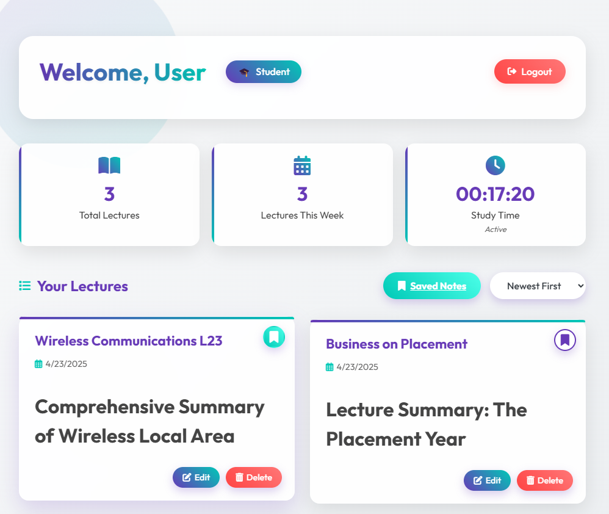
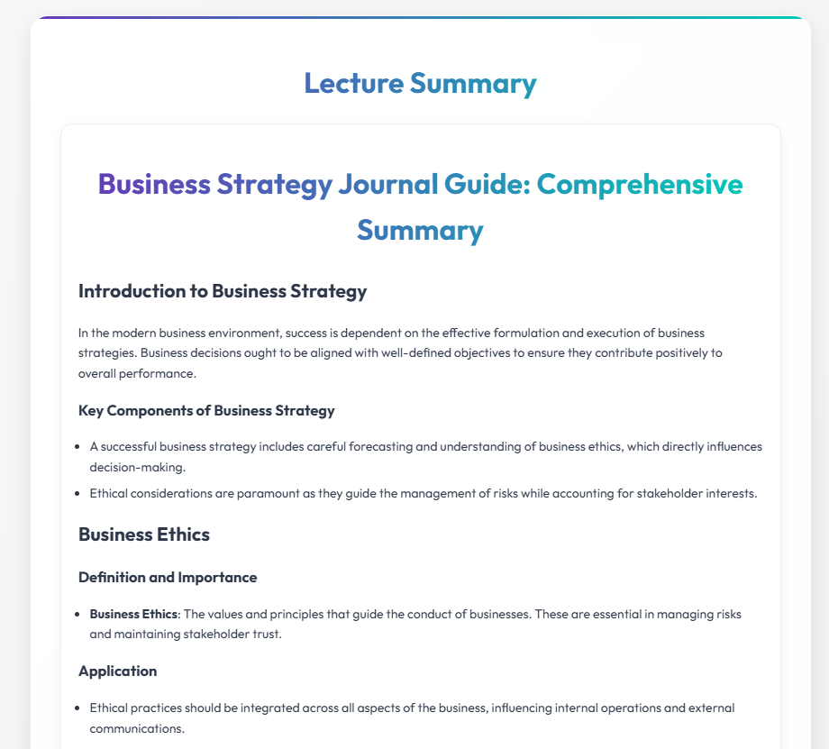
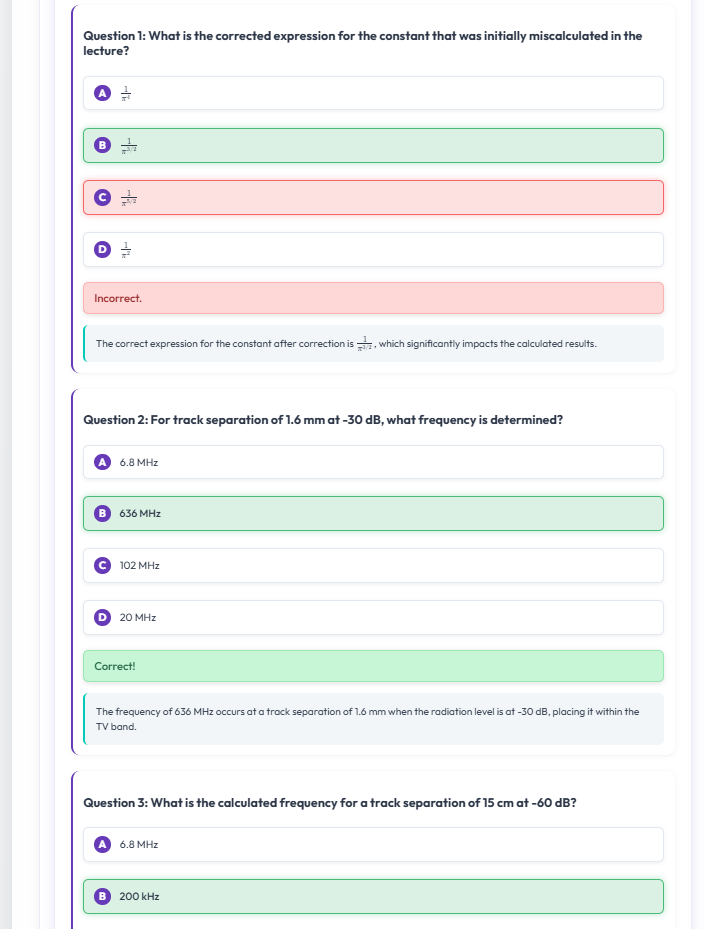
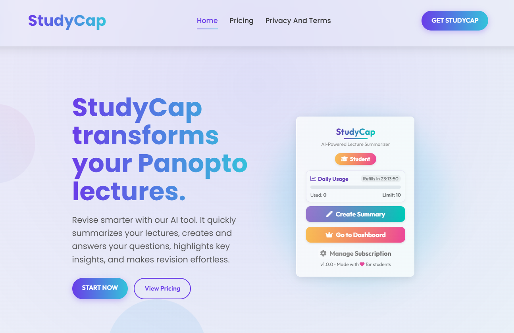
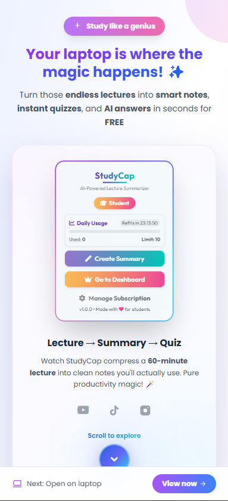
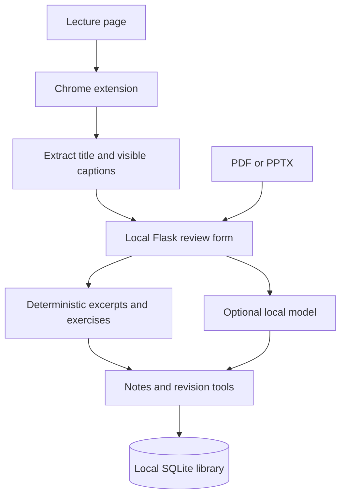

# StudyCap

StudyCap brings lecture captions, slide text and revision tools into one workflow. [Ruben Fernandez](https://github.com/rubenfernandezz) and [Vasilis Pittalis](https://github.com/VasmanARF) co-developed a Chrome extension to capture lecture captions and a Flask application to organise study notes, answer questions and generate quizzes.

This repository includes a runnable local demonstration and screenshots of the original product. The default demo selects source excerpts, searches passages and creates recall exercises. An optional local model generates notes and multiple-choice questions.

## Product showcase

The original dashboard organised saved lectures and provided bookmarks, sorting and editing.



The original viewer structured generated notes into topics and explanations.



Quizzes marked answers and explained corrections.



The desktop product page introduced the extension and its capture-to-dashboard workflow.



Mobile onboarding directed students to continue with the Chrome extension on a laptop.



## Run the complete demo

Use Python 3.13 and Chrome. From the repository root in Windows PowerShell:

```powershell
cd web-app
py -3.13 -m venv .venv
.\.venv\Scripts\python.exe -m pip install --only-binary=:all: -r requirements.txt
.\.venv\Scripts\python.exe app.py
```

On macOS or Linux, use `python3.13` to create the virtual environment and `.venv/bin/python` for subsequent commands. Windows is the tested platform.

1. Open `chrome://extensions`, enable Developer mode and choose Load unpacked. Select `browser-extension/` from this repository.
2. Open [the synthetic practice lecture](http://127.0.0.1:5050/practice). With the lecture tab active, open the extension and choose Capture captions.
3. Review the four caption lines, optionally attach a trusted PDF or PPTX, and save the study notes.
4. Edit the notes, create a recall exercise, search for a passage, export a Word-compatible document or print to PDF. Return to the library to reopen the lecture.

The [web application guide](web-app/README.md) covers model configuration, document limits and local storage. The [extension guide](browser-extension/README.md) explains capture permissions and supported page layouts. You can also try synthetic captions directly from the library without loading the extension.

## Architecture



The public edition uses Python, Flask, Jinja, SQLite and browser JavaScript with Manifest V3. pypdf and python-pptx extract document text. The original project used MySQL, Google sign-in, hosted generation, Stripe subscriptions and related-video search. The retained prompt branches and ranking routine demonstrate that work through local equivalents and synthetic resources. Browser sessions scope access to saved lectures, CSRF tokens protect writes, and the extension transfers a capture once through short-lived session storage.

## Collaboration and contributions

Ruben contributed to dashboard lecture loading and bookmarks, viewer quizzes and maths rendering, related-video ranking in Flask, and extension popup progress feedback and active-tab script injection. Vasilis contributed to lecture persistence, Google sign-in, subscription webhooks, uploads, server-side generation, caption extraction and summary formatting. Both changed the application, viewer and extension. These statements follow the shared Git diffs. The local demo interface, SQLite storage and loopback handoff were prepared for this portfolio edition.

## Verification and limits

Run the web tests from `web-app/` with `.\.venv\Scripts\python.exe -B -m unittest discover -s tests -v`. From the repository root, run `node --test browser-extension/tests/handoff.test.cjs` for extension checks.

The practice lecture, file imports and browser handoff use synthetic test material. Actual model inference and live Panopto layouts require separate validation. The local library stores plaintext data under `web-app/instance/`. Original-product screenshots show historical hosted features. The local setup and its available functions are detailed in the component guides.

Ruben Fernandez and Vasilis Pittalis share development credit. The original production codebase, with credentials removed, is published at [VasmanARF/studycap](https://github.com/VasmanARF/studycap). Publication permissions and branding approval remain under owner review.

## License

[MIT](LICENSE)
