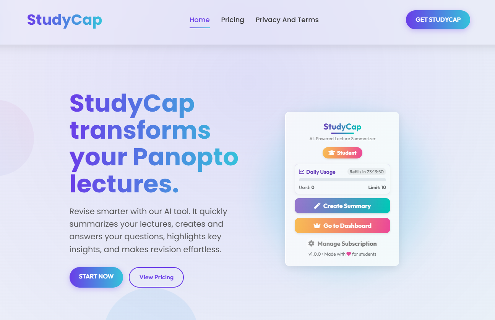
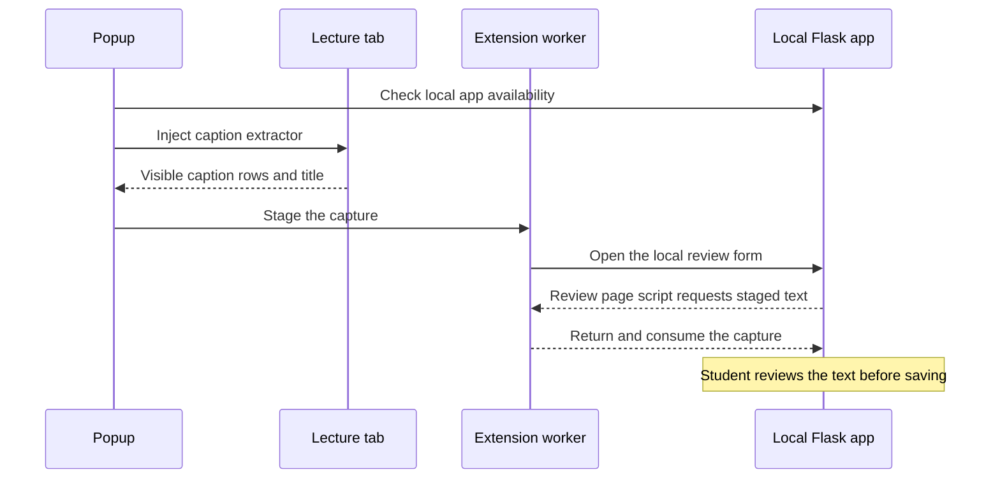
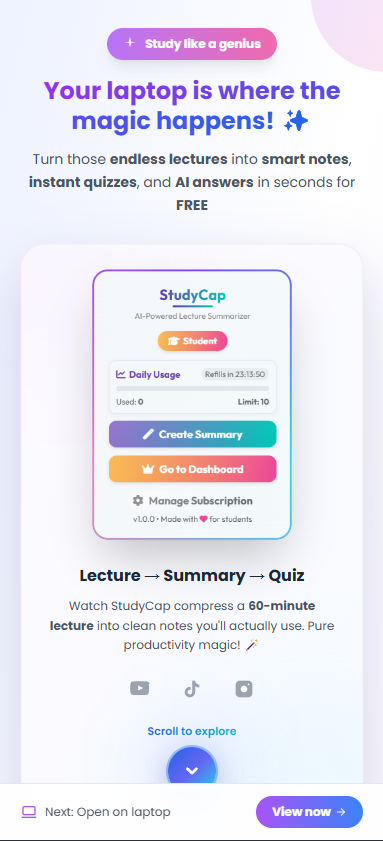

# StudyCap · Chrome lecture capture

This Manifest V3 extension captures the captions already visible on a lecture page and opens them in the [StudyCap web application](../web-app/README.md). Students can check the transcript, add slides and keep the resulting notes in their local lecture library. Capture starts when the student opens the popup and chooses **Capture captions**.

**Original desktop product page.** The page introduced StudyCap to Panopto users and showed how to create a summary or open the lecture dashboard from the extension.

## Try the complete workflow

1. Follow the companion web app’s README to start Flask. The public demo needs no account, payment, API key or model.
2. Open `chrome://extensions`, enable **Developer mode**, select **Load unpacked** and choose the monorepo’s `browser-extension/` folder containing `manifest.json`. The extension runs directly without a build or npm install.
3. Open the [synthetic practice lecture](http://127.0.0.1:5050/practice). With that tab active, open the StudyCap popup and select **Capture captions**.
4. Check that the review form contains the title **Feedback control** and its four caption lines. Edit the text or attach a PDF/PPTX, select **Save study notes**, then **Create recall exercise** in the viewer.

## What happens after a click

The popup uses `activeTab` and `scripting` to read the chosen tab. The extractor tries the project’s lecture-title selectors and joins rendered caption rows in order. A service worker uses `storage.session` to pass the capture to the review page across the popup’s lifetime. Only an opaque identifier appears in the URL fragment. The handoff expires after two minutes, and a successful read removes the staged text. Expired entries are pruned on later messages.

The popup checks a public status marker at `http://127.0.0.1:5050` before it reads a lecture. If the app is unavailable, start it and retry. Both the worker and the review-page script verify the exact local origin. Chrome does not load `.env` files for this package. The fixed loopback address requires no configuration.

## Original product and public edition

The original popup coordinated access checks, progress feedback, optional slide upload and summary generation through a hosted web service. The public edition retains the user-triggered capture and DOM selectors. It moves file upload and processing into the local review form. By default the app selects excerpts and creates recall exercises. An optional local model can generate notes and multiple-choice quizzes.

**Original mobile onboarding.** Students who discovered StudyCap on a phone could see the lecture-to-summary-to-quiz workflow and continue on a laptop to use the Chrome extension.

The synthetic practice page is the verified path. The extractor also recognises HTTPS Panopto `.com` and `.eu` pages with the expected top-level caption panel. Open that panel before capture. Embedded players, custom domains and captions outside the rendered DOM may require different extraction logic. The extension does not transcribe audio.

## Engineering contributions

Ruben Fernandez and Vasilis Pittalis co-developed the extension. Ruben contributed to popup loading and progress feedback, active-tab script injection and browser-local state. Vasilis contributed to caption extraction, summary formatting, the summary-start flow and daily-limit checks. Both worked on the popup and the content script.

**CV summary:** Co-developed a Chrome extension for lecture capture, contributing to popup progress feedback and the interaction between the popup and the active lecture tab.

Run `node --test tests/handoff.test.cjs` to check one-time delivery, origin checks and expiry. The manual workflow above exercises the unpacked extension and the companion Flask application together.
