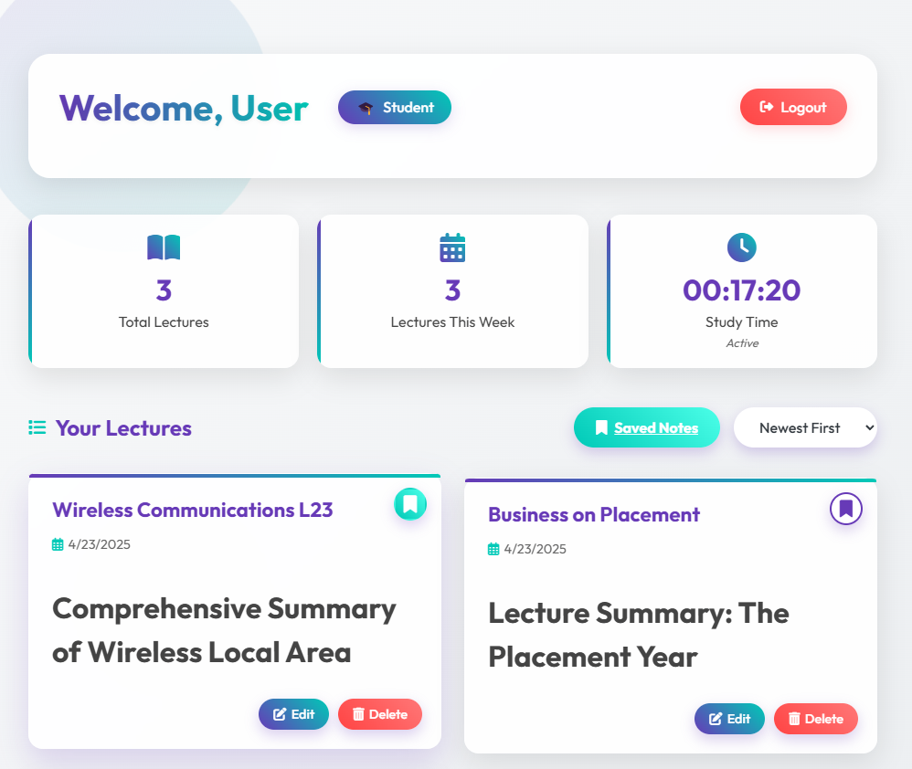
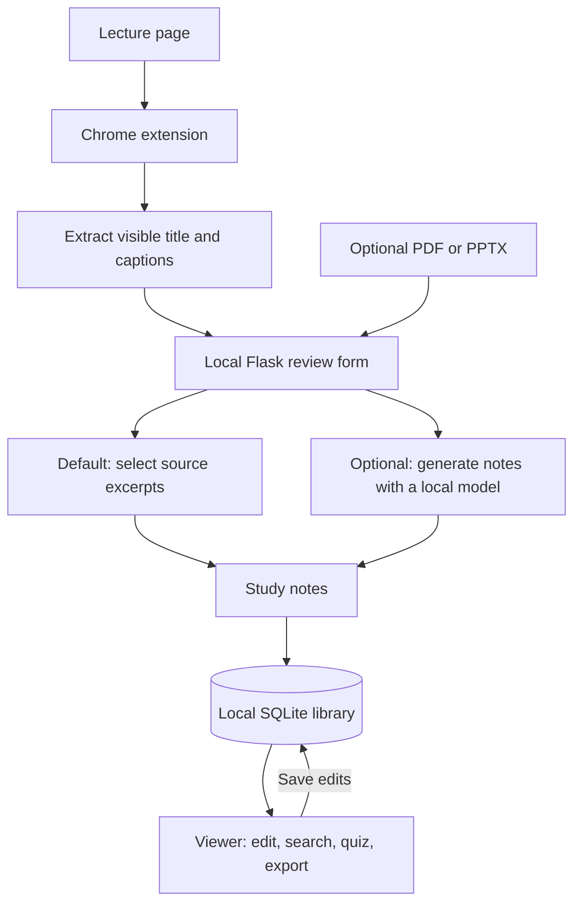
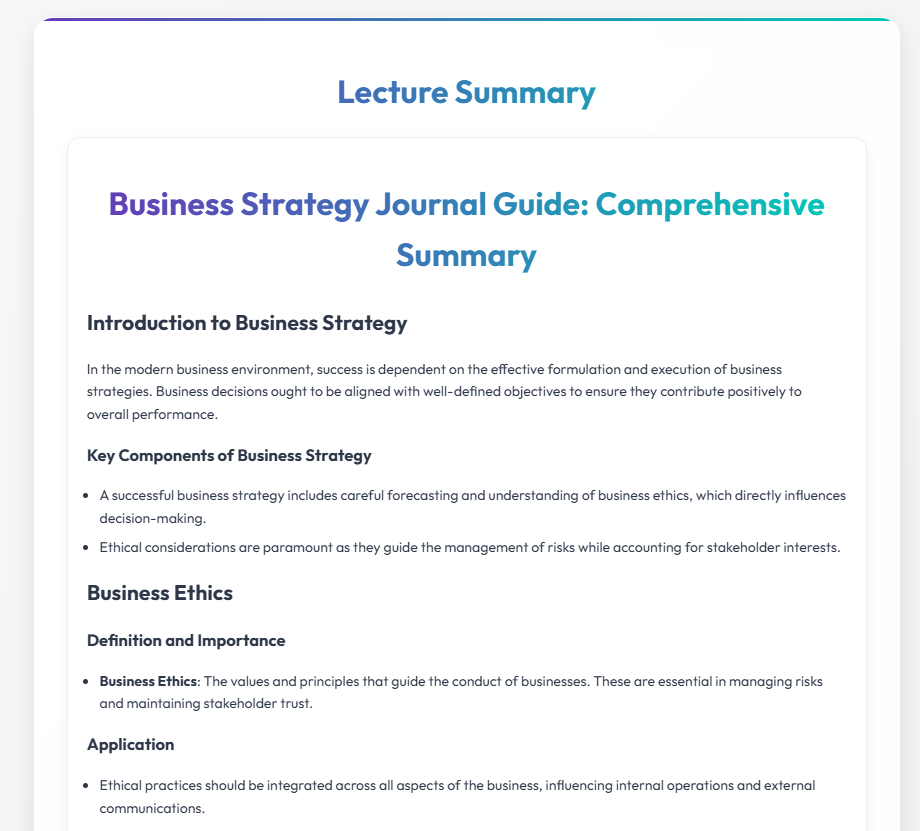
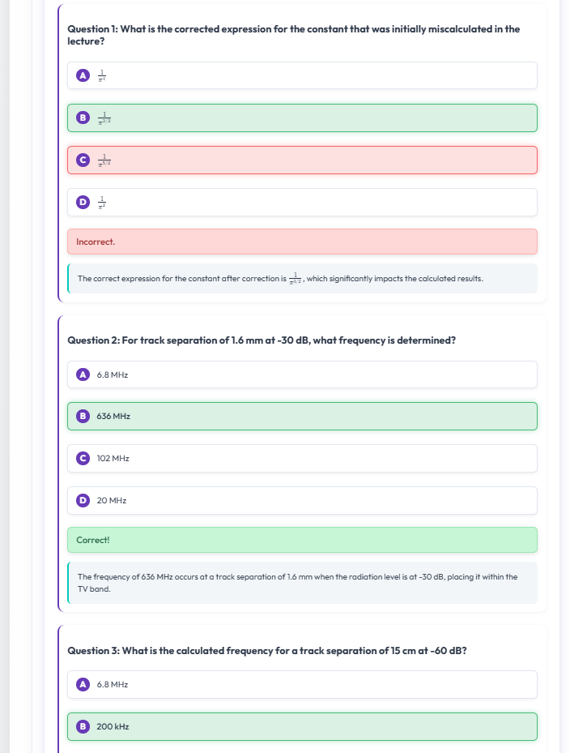

# StudyCap · Lecture notes and revision

StudyCap helps students revise a recorded lecture without switching between its transcript, slides and a separate set of notes. The [companion Chrome extension](../browser-extension/README.md) captures the visible captions. This Flask application lets the student review them, add slide text, save a lecture and practise recalling it.

**Original StudyCap dashboard.** Students could reopen a lecture, bookmark it for revision, or edit its title from the library.



**Try it without an account or model.** The included feedback-control lecture runs entirely on your computer. The default processor selects excerpts from the source text. A local model is optional.

## Run the demo

Use Python 3.13. From the monorepo root in Windows PowerShell, run `cd web-app` first. Then run:

```powershell
py -3.13 -m venv .venv
.\.venv\Scripts\python.exe -m pip install --only-binary=:all: -r requirements.txt
.\.venv\Scripts\python.exe app.py
```

On macOS or Linux, create the environment with `python3.13 -m venv .venv` and use `.venv/bin/python` for the next two commands. Windows with Python 3.13 is the tested platform.

1. Open the [lecture library](http://127.0.0.1:5050/) and select **Try synthetic captions**. To test capture too, load the companion extension, open **Practice lecture** and select **Capture captions**.
2. Review the transcript, optionally attach a PDF or PPTX, then select **Save study notes**. Open **Edit title and notes** to add an annotation.
3. Select **Create recall exercise** and reveal an answer. Return to **Lecture library** to reopen the saved lecture. The viewer also supports passage search, a Word-compatible download and browser Print to PDF.

## From capture to revision



Flask and Jinja serve the library and viewer. The extension hands text to a review form so the student can correct it before saving. pypdf and python-pptx extract selectable text from uploaded files. The app accepts trusted local documents up to 8 MiB per request, up to 100 PDF pages and 60,000 extracted characters. Scanned pages need OCR elsewhere.

The original application used Google sign-in, MySQL, hosted generation, subscription tiers and a YouTube search pipeline. The public edition uses a signed browser cookie and SQLite. It keeps the original prompt branches for captions, slides, chat and multiple-choice quizzes. The video-ranking algorithm is available against a small synthetic catalogue. Its MySQL predecessor is illustrated with [schema and query excerpts](docs/original-storage.md).

## Inside the original study workspace

**From transcript to study notes.** This business strategy lecture shows how the original viewer organised the generated summary into topics, definitions and examples.



**From notes to revision.** The quiz marked each answer and explained the result. This engineering example shows both a corrected answer and a correct response.



## Processing modes and storage

| | Default offline mode | Optional local model |
|---|---|---|
|Notes | First eight distinct lines from each source | Generated from captions, slides or both |
|Questions about notes | Retrieves passages by matching words | Sends the question and saved notes to the configured model |
|Revision | Fill-in-the-blank recall exercises | Multiple-choice questions with answers and explanations |

To enable the model, copy `.env.example` to `.env`, set `STUDYCAP_MODEL` to your installed model name and `STUDYCAP_MODEL_PORT` to its loopback port, then restart Flask. The adapter sends requests to `/v1/chat/completions` at `127.0.0.1` and expects JSON-object support for quizzes. The adapter was tested with a local protocol fixture. Model weights and a model server are separate.

Each browser session owns its library. Use the same browser profile and cookie to reopen it after restarting the app. The database under `instance/` contains local plaintext notes. The Word-compatible export contains HTML in a `.doc` file. Equations remain readable as LaTeX source in the public viewer.

## Engineering contributions

Ruben Fernandez and Vas co-developed StudyCap. Ruben contributed to loading and bookmarking lectures on the dashboard, quiz and maths rendering in the viewer, and ranking related videos in Flask. Vas contributed to the MySQL lecture library, Google sign-in, Stripe subscription webhooks, document uploads and the server-side generation endpoint. Both worked on the Flask application and lecture viewer.

**CV summary:** Co-developed a lecture revision application with Flask and JavaScript, contributing to related-video ranking, saved-lecture workflows and interactive quizzes.

Run the functional suite with `.\.venv\Scripts\python.exe -B -m unittest discover -s tests -v`. It exercises the library, edits, ownership checks, exercises and imports using synthetic PDF and PPTX files.
